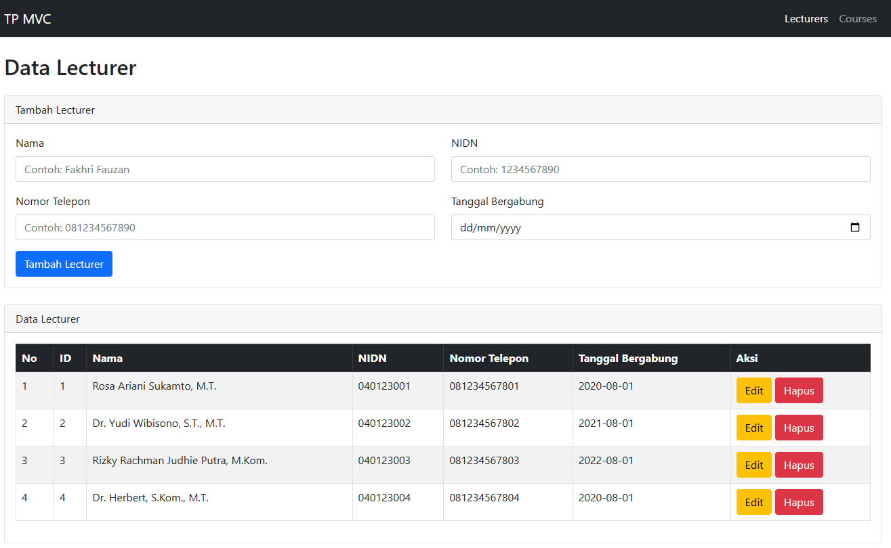
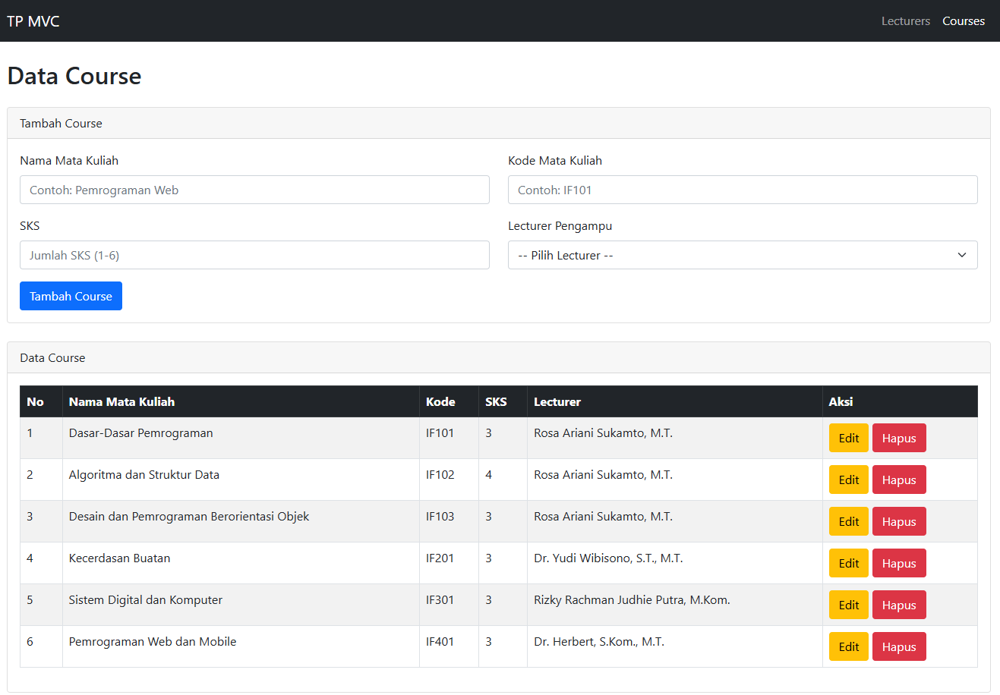

# TP8 DPBO 2025/2026

## Data Diri

| Keterangan  | Data                                      |
| ----------- | ----------------------------------------- |
| Nama        | Fakhri Fauzan                             |
| NIM         | 2501536                                   |
| Kelas       | C2                                        |
| Mata Kuliah | Desain dan Pemrograman Berorientasi Objek |

## Janji

Saya Fakhri Fauzan dengan NIM 2501536 mengerjakan Tugas Praktikum 8 dalam mata kuliah Desain dan Pemrograman Berorientasi Objek. Untuk keberkahan-Nya, saya tidak melakukan kecurangan seperti yang telah dispesifikasikan. Aamiin.

---

## Deskripsi Program

TP8 merupakan aplikasi web pengelolaan data Lecturer (dosen) dan Course (mata kuliah) yang dibuat menggunakan PHP Native dan MySQL. Aplikasi ini menerapkan pola arsitektur Model-View-Controller (MVC) untuk memisahkan pengelolaan data, alur request, dan tampilan.

Aplikasi menyediakan fitur CRUD (Create, Read, Update, Delete) untuk data Lecturer dan Course. Setiap Lecturer dapat mengampu lebih dari satu Course. Pada halaman Course, nama Lecturer ditampilkan sebagai pengampu, sedangkan pada form pengelolaan Course, pengguna dapat memilih Lecturer yang tersedia.

## Desain dan Fungsi Program

### 1. Konsep MVC

MVC (Model-View-Controller) merupakan pola arsitektur yang memisahkan aplikasi menjadi beberapa bagian berdasarkan tanggung jawabnya, sehingga pengelolaan data, alur program, dan tampilan tidak bercampur dalam satu bagian.

Berikut penerapan MVC pada program TP8:

| Bagian              | File pada TP8                                                                              | Tanggung Jawab                                                                                                                                          |
| ------------------- | ------------------------------------------------------------------------------------------ | ------------------------------------------------------------------------------------------------------------------------------------------------------- |
| Entry Point         | `tp_mvc25/index.php`, `tp_mvc25/course.php`                                                | Menjadi pintu masuk request browser, menentukan aksi berdasarkan request GET/POST, memanggil Controller, dan mengatur redirect setelah proses tertentu. |
| Controller          | `tp_mvc25/controllers/LecturerController.php`, `tp_mvc25/controllers/CourseController.php` | Mengatur alur fitur, memvalidasi input, memanggil Model, serta meneruskan data dan pesan kepada View.                                                   |
| Model               | `tp_mvc25/models/Lecturer.php`, `tp_mvc25/models/Course.php`                               | Mengelola operasi database pada tabel masing-masing, seperti mengambil, menambah, memperbarui, dan menghapus data.                                      |
| Database Connection | `tp_mvc25/models/DB.php`, `tp_mvc25/config.php`                                            | `DB` mengelola koneksi PDO dan eksekusi query terparameterisasi, sedangkan `Config` menyimpan konfigurasi koneksi database.                             |
| View                | `tp_mvc25/views/LecturerView.php`, `tp_mvc25/views/CourseView.php`                         | Menyiapkan data yang dibutuhkan untuk tampilan, seperti baris tabel, opsi form, nilai form, dan pesan informasi.                                        |
| Template            | `tp_mvc25/views/Template.php`                                                              | Membaca template HTML, mengganti token tampilan dengan data yang disiapkan, dan menghasilkan halaman HTML.                                              |
| HTML Template       | `tp_mvc25/templates/lecturer.html`, `tp_mvc25/templates/course.html`                       | Menyediakan struktur halaman dan komponen antarmuka yang menggunakan Bootstrap.                                                                         |

`index.php` berfungsi sebagai entry point utama aplikasi sekaligus halaman pengelolaan Lecturer. Sementara itu, `course.php` merupakan entry point untuk halaman pengelolaan Course.

Dengan pemisahan tersebut, query database tidak ditulis di dalam template HTML. Entry point menerima request, Controller mengatur proses, Model berinteraksi dengan database, dan View menyiapkan tampilan yang kemudian dirender oleh Template.

### 2. Alur Request MVC

#### Menampilkan Data (Read)

1. Browser membuka `index.php` untuk halaman Lecturer atau `course.php` untuk halaman Course.
2. Entry point memanggil method `index()` pada Controller terkait.
3. Controller meminta data kepada Model.
4. Model menjalankan query melalui class `DB`.
5. Controller meneruskan hasil query kepada View.
6. View menyiapkan data untuk template HTML.
7. Template mengganti token dengan data yang tersedia dan menampilkan halaman kepada user.

#### Menambah Data (Create)

1. User mengisi form dan mengirim data menggunakan request POST.
2. Entry point meneruskan request kepada Controller.
3. Controller memeriksa field wajib dan melakukan validasi input.
4. Jika input valid, Controller memanggil Model untuk menyimpan data.
5. Model menjalankan query INSERT melalui `DB`.
6. Setelah proses berhasil, user diarahkan kembali ke halaman terkait untuk melihat data terbaru.

#### Mengubah Data (Update)

1. User menekan tombol Edit pada data yang dipilih.
2. ID data dikirim melalui URL menggunakan request GET.
3. Controller mengambil data berdasarkan ID melalui Model.
4. View menampilkan form edit yang telah terisi data sebelumnya.
5. User mengubah data dan mengirim form menggunakan request POST.
6. Controller melakukan validasi input dan memanggil Model untuk memperbarui data.
7. Setelah berhasil, user diarahkan kembali ke halaman daftar data.

Tombol Cancel pada mode edit digunakan untuk kembali ke halaman daftar tanpa menyimpan perubahan.

#### Menghapus Data (Delete)

1. User menekan tombol Delete pada data yang ingin dihapus.
2. Browser menampilkan konfirmasi penghapusan.
3. Jika user menyetujui, request diteruskan kepada entry point dan Controller.
4. Controller memanggil Model untuk menghapus data.
5. Model menjalankan query DELETE melalui `DB`.
6. User diarahkan kembali ke halaman terkait setelah proses selesai.

Lecturer yang masih memiliki Course tidak dapat dihapus karena adanya relasi foreign key pada database.

### 3. Fitur dan Validasi

#### Lecturer

- Menampilkan data Lecturer berupa ID, nama, NIDN, nomor telepon, dan tanggal bergabung.
- Menambahkan data Lecturer.
- Mengubah data Lecturer.
- Menghapus data Lecturer.
- Memastikan field wajib telah diisi.
- Validasi nomor telepon hanya menerima angka.
- Menampilkan feedback setelah proses CRUD.
- Menampilkan konfirmasi sebelum penghapusan data.
- Mencegah penghapusan Lecturer yang masih memiliki Course.

#### Course

- Menampilkan data Course berupa nama mata kuliah, kode mata kuliah, SKS, dan nama Lecturer pengampu.
- Menambahkan data Course.
- Mengubah data Course.
- Menghapus data Course.
- Menyediakan pilihan Lecturer yang tersedia pada form.
- Memastikan field wajib telah diisi.
- Validasi SKS harus berupa bilangan bulat antara 1 hingga 6.
- Menampilkan feedback setelah proses CRUD.
- Menampilkan konfirmasi sebelum penghapusan data.

## Database

Aplikasi menggunakan database MySQL bernama `tp_mvc25` yang terdiri dari dua tabel, yaitu `lecturers` dan `courses`.

### 1. Struktur Tabel

#### Tabel `lecturers`

| Atribut     | Tipe Data    | Keterangan                  |
| ----------- | ------------ | --------------------------- |
| `id`        | INT          | Primary Key, Auto Increment |
| `name`      | VARCHAR(100) | Nama Lecturer               |
| `nidn`      | VARCHAR(20)  | Nomor induk dosen           |
| `phone`     | VARCHAR(20)  | Nomor telepon               |
| `join_date` | DATE         | Tanggal bergabung           |

#### Tabel `courses`

| Atribut       | Tipe Data    | Keterangan                                |
| ------------- | ------------ | ----------------------------------------- |
| `id`          | INT          | Primary Key, Auto Increment               |
| `lecturer_id` | INT          | Foreign Key yang mengacu pada ID Lecturer |
| `course_name` | VARCHAR(100) | Nama mata kuliah                          |
| `course_code` | VARCHAR(20)  | Kode mata kuliah                          |
| `credits`     | INT          | Jumlah SKS                                |

### 2. Relasi Database

Relasi antara tabel `lecturers` dan `courses` adalah **One-to-Many**, yaitu satu Lecturer dapat mengampu beberapa Course, sedangkan satu Course memiliki satu Lecturer pengampu.

Kolom `lecturer_id` pada tabel `courses` merupakan foreign key yang mengacu pada kolom `id` pada tabel `lecturers`.

Relasi ini menjaga konsistensi data, sehingga Course tidak dapat mengacu pada Lecturer yang tidak tersedia. Selain itu, Lecturer yang masih memiliki Course tidak dapat dihapus karena foreign key menggunakan aturan `ON DELETE RESTRICT`.

File database tersedia pada:

`tp_mvc25/database/tp_mvc25.sql`

## Cara Menjalankan Program

1. Pastikan PHP, MySQL, dan web server (misalnya XAMPP) telah tersedia.
2. Jalankan Apache dan MySQL melalui XAMPP.
3. Letakkan folder repository `TP8DPBO2526C2` di dalam direktori `htdocs`.
4. Buat database MySQL dengan nama `tp_mvc25`.
5. Import file `tp_mvc25/database/tp_mvc25.sql` ke database tersebut.
6. Periksa konfigurasi host, username, password, dan nama database pada file `tp_mvc25/config.php`. Sesuaikan dengan konfigurasi lokal jika diperlukan.
7. Buka aplikasi melalui browser pada alamat:

   `http://localhost/TP8DPBO2526C2/tp_mvc25/`

8. Gunakan navigasi **Lecturers** dan **Courses** untuk berpindah halaman dan mengelola data.

## Dokumentasi

### Tampilan Lecturer

Berikut merupakan tampilan halaman pengelolaan data Lecturer yang menyediakan fitur untuk menampilkan, menambah, mengubah, dan menghapus data dosen.



### Tampilan Course

Berikut merupakan tampilan halaman pengelolaan Course yang menampilkan data mata kuliah beserta Lecturer yang mengampunya.



### Video Demo

Video demonstrasi aplikasi mencakup penggunaan fitur CRUD (Create, Read, Update, Delete) pada Lecturer dan Course, serta interaksi antara kedua data tersebut.

[▶️ Tonton Video Demo TP8 — Lecturer & Course CRUD](https://youtu.be/46ufHvvDfBo)

## Struktur Repository

```text
TP8DPBO2526C2/
├── README.md
├── Dokumentasi/
│   ├── Lecturer.png
│   └── Course.png
└── tp_mvc25/
    ├── assets/
    │   ├── bootstrap.bundle.min.js
    │   ├── bootstrap.min.css
    │   ├── bootstrap.min.js
    │   ├── jquery.min.js
    │   └── popper.min.js
    ├── controllers/
    │   ├── CourseController.php
    │   └── LecturerController.php
    ├── database/
    │   └── tp_mvc25.sql
    ├── models/
    │   ├── Course.php
    │   ├── DB.php
    │   └── Lecturer.php
    ├── templates/
    │   ├── course.html
    │   └── lecturer.html
    ├── views/
    │   ├── CourseView.php
    │   ├── LecturerView.php
    │   └── Template.php
    ├── config.php
    ├── course.php
    └── index.php
```

## Kesimpulan

Program TP8 merupakan aplikasi pengelolaan data Lecturer dan Course menggunakan PHP Native dan MySQL dengan penerapan pola arsitektur Model-View-Controller (MVC).

Entry point dan Controller mengatur alur request serta validasi, Model mengelola operasi database, sedangkan View dan Template bertanggung jawab menyiapkan serta menampilkan antarmuka.

Relasi One-to-Many melalui foreign key menghubungkan setiap Course dengan Lecturer pengampunya, sekaligus menjaga konsistensi data dalam database. Dengan penerapan MVC, struktur program menjadi lebih terorganisasi dan pemisahan tanggung jawab setiap komponen menjadi lebih jelas.
